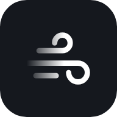

<p align="center">
  
</p>

<h1 align="center">Anemo</h1>

<p align="center">
  <b>A self-hosted AI workspace for one person: chat, agents that ask before they act,
  and your own documents, files, tasks and calendar for them to work on.</b>
</p>

<p align="center">
  <a href="https://hub.docker.com/r/essntl/anemo"></a>
  <a href="LICENSE"></a>
  <a href="https://github.com/essntl/anemo/stargazers"></a>
</p>

Anemo runs on your own server (a homelab box, a NAS, ZimaOS) with Docker Compose. You
bring the models: an API key for OpenAI, Anthropic or OpenRouter, a local model in
Ollama, or your Claude Pro or Max subscription. Anemo gives them a place to work: a chat,
an Agent mode with tools, and a workspace of Markdown documents, files, tasks and a
calendar that you use too. Every tool call an agent makes is checked on the server
against permissions you set, so it can do real work in your workspace without getting
the run of your machine.

It is built for one person who wants their assistant, notes and planning in one place
they control: one login, and your data in your own database and folders. For a second
person, run a second copy.

## What it does

**Chat and agents**

- **Chat and Agent mode.** Answers stream from a background worker, so they keep going
  through reloads and restarts. Agent mode adds tools: files, shell, web, a browser,
  documents, tasks, calendar and MCP.
- **Permissions you set.** Per category: *Never*, *Always ask*, *Ask for dangerous
  actions*, *Allowed in workspace* or *Fully autonomous*. A run waiting for approval
  holds no worker; paths outside the workspace, settings and secrets are always refused.
- **Plans, limits and runs.** Review the agent's plan before it acts, pause and resume
  runs, cap steps, time and cost, and see every run's tool calls and file changes, with
  one-click revert.
- **Profiles, skills and sub-agents.** Reusable agent setups, `SKILL.md`-style skills as
  slash commands (`/study`, `/plan`, `/fact-check`, `/diagram`, …), and sub-agents that
  never get more permissions than the agent that started them.
- **Memory you can see.** It remembers what you tell it and suggests what it noticed;
  every memory is on one page to edit or delete.
- **Your choice of model.** OpenAI, Anthropic, OpenRouter, any OpenAI-compatible server
  (Ollama, …), or **your Claude subscription** through the official Claude Code CLI.
  Fallback models, and usage and cost for every call.

**Your workspace**

- **Documents.** Plain Markdown files in your workspace with a rich editor, autosave,
  version history and links between documents, tasks and files.
- **Files.** A file manager for the workspace. Attach PDFs, Word, Excel, PowerPoint, zips
  or images to a chat; agents can hand files back to you.
- **Tasks and calendar.** List and board, checklists, subtasks, *waits on*, repeating
  tasks and reminders; a month, week, day and agenda calendar.
- **Projects** group chats, tasks, events, documents and files, with their own
  instructions for the assistant.
- **Home** with widgets and a daily note, a **focus timer**, a **music** player, **stats**
  and the **Dynamic Island**.
- **Diagrams, charts and math** drawn in answers and documents (Mermaid, charts, LaTeX).
- **Search everything** with Ctrl+K, and **share links**: read-only copies of a chat,
  document or project.

**Automation and reach**

- **Automations.** Prompts an agent runs on a schedule (cron), with results as
  notifications or documents. Approvals are never given automatically.
- **Notifications** in the app, as push on your phone or computer (with Allow / Deny
  buttons), on the desktop, or in Discord.
- **MCP servers**, remote by URL or local (`npx`, `uvx`) in an isolated container; every
  MCP tool goes through the same permissions.
- **Web search** through your own SearXNG, reading pages and calling APIs, with addresses
  on your own network refused unless you allow them.
- **A browser for agents.** A headless Chromium in its own container, which you can watch
  and take over live, for example to log in.
- **Shell sandboxes.** Commands run in a separate container with no network by default,
  each rated safe, moderate or dangerous before it runs; a second one for commands that
  need the internet.
- **Browser extension** (Anemo Companion): Anemo in Chrome's side panel, with page
  context, capture, translate and research.
- **On your phone**: installable to the home screen, with push notifications. In English,
  Ukrainian and Russian.

**Devices**

- **Voice from your phone** (Anemo Voice, Android): say the wake word and what you want;
  it runs as an agent request and the phone reads the answer out. Questions and
  approvals are answered by voice, except dangerous actions, which need a tap.
- **Your Windows computers** (Anemo Desktop): a tray program that lets the agent look at
  the screen, click, type, open programs and, on a trusted computer, run PowerShell.
  Each computer has its own trust level: on your own PC every action asks; the agent's
  own VM can be left to work on its own. A stop hotkey takes control away at once.
- Both connect out to Anemo through the address the web app uses; no port is opened on
  the computer or phone. Set up in **Settings → Devices**; the proxy needs
  [Websockets Support](docs/deployment.md#behind-nginx-proxy-manager).

All the details, area by area: **[docs/features.md](docs/features.md)**.

## Install

You need a Linux machine (or ZimaOS / CasaOS) with Docker and the Compose plugin, and
about 2 GB of free memory.

**From source**

```bash
git clone https://github.com/essntl/anemo.git && cd anemo
cp .env.example .env
# edit .env: APP_SECRET_KEY, POSTGRES_PASSWORD, ADMIN_PASSWORD(_HASH), WORKSPACE_PATH
docker compose up -d
```

Open `http://<server>:8080` and log in. A short setup walks you through adding a model
provider. The agents' browser, the MCP host and the Claude runner are optional:
`docker compose --profile browser up -d` (or `mcp`, `claude`).

**Prebuilt images, no build**

Images for x86-64 and ARM64 are built from `main` on every change. Save
[`docker-compose.prebuilt.yml`](docker-compose.prebuilt.yml) in a folder of its own
as `docker-compose.yml`, replace every `CHANGE_ME` (the comments at the top say what goes
where), then run `docker compose pull && docker compose up -d` there and open
`http://<server>:8484`. No checkout, no build, no `.env`.

**ZimaOS / CasaOS**

Fill in the `CHANGE_ME`s in
[`deploy/zimaos/docker-compose.yml`](deploy/zimaos/docker-compose.yml), save it as
`/DATA/AppData/anemo/docker-compose.yml` from a terminal on the server, run
`docker compose up -d` in that folder and open `http://<your-zimaos-address>:8484`.
Use the terminal rather than the ZimaOS app import, which rewrites the file:
[why](docs/deployment.md#zimaos--casaos).

Then: [HTTPS behind Nginx Proxy Manager](docs/deployment.md#behind-nginx-proxy-manager) ·
[backups](docs/backup.md) · [updates](docs/deployment.md#updating) ·
[more than one copy](docs/deployment.md#more-than-one-copy-on-a-server).

## Documentation

- [Features](docs/features.md): everything Anemo does, area by area
- [Deployment](docs/deployment.md): install, first-time setup, proxy, updates, services
- [Backup and restore](docs/backup.md)
- [Security and permissions](docs/security.md)
- [Claude subscription](docs/claude-code.md)
- [Browser extension](extension/README.md)
- [Architecture](docs/architecture.md) · [Development](docs/development.md) ·
  [Roadmap](docs/roadmap.md)

## Star history

<a href="https://star-history.com/#essntl/anemo&Date">
  <picture>
    <source media="(prefers-color-scheme: dark)" srcset="https://api.star-history.com/svg?repos=essntl/anemo&type=Date&theme=dark">
    
  </picture>
</a>

## Author

Made by **essntl** · [X (@artemkdev)](https://x.com/artemkdev) · [artemk.dev](https://artemk.dev)

Licensed under the [GNU GPL v2](LICENSE).
