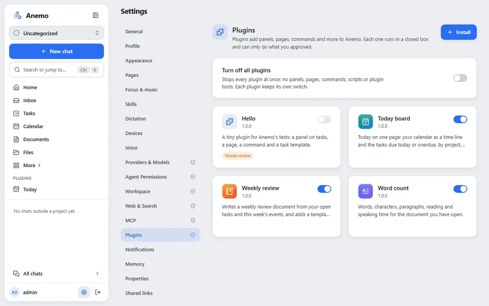
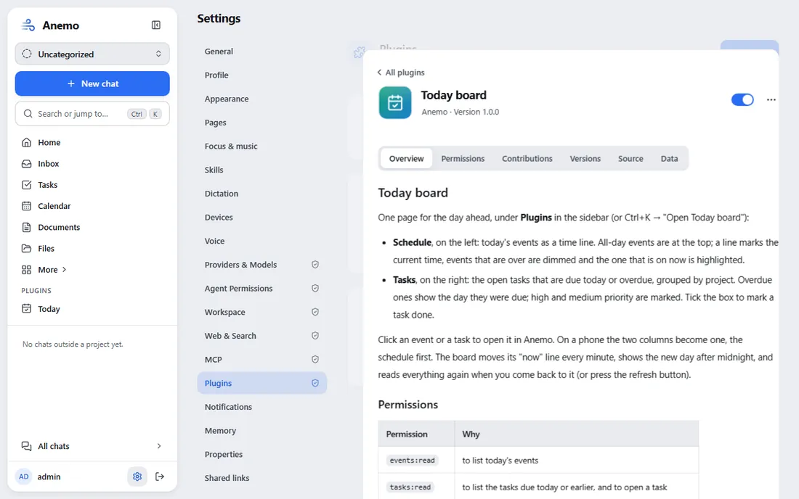
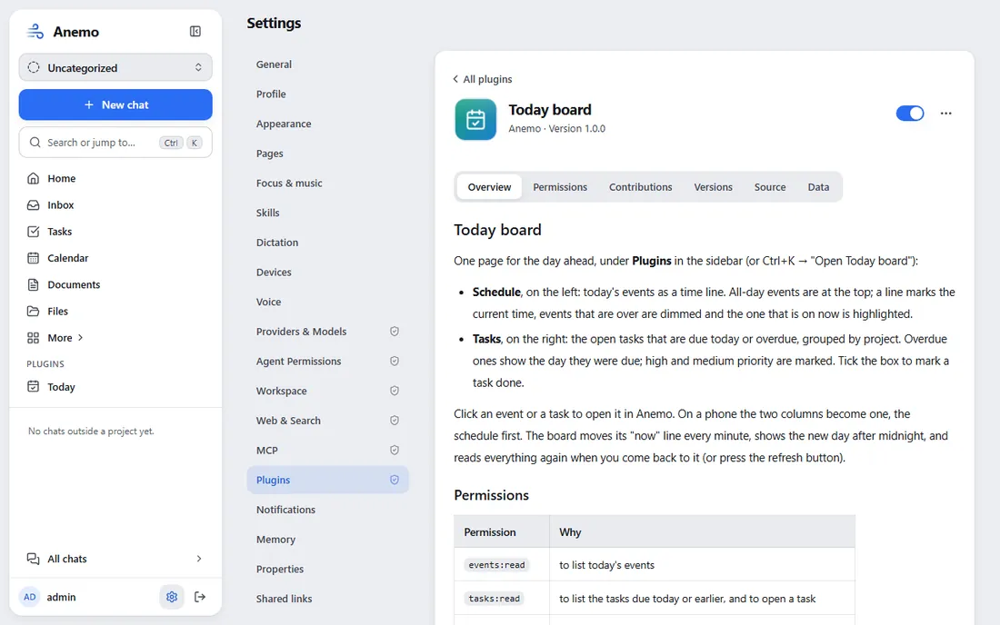
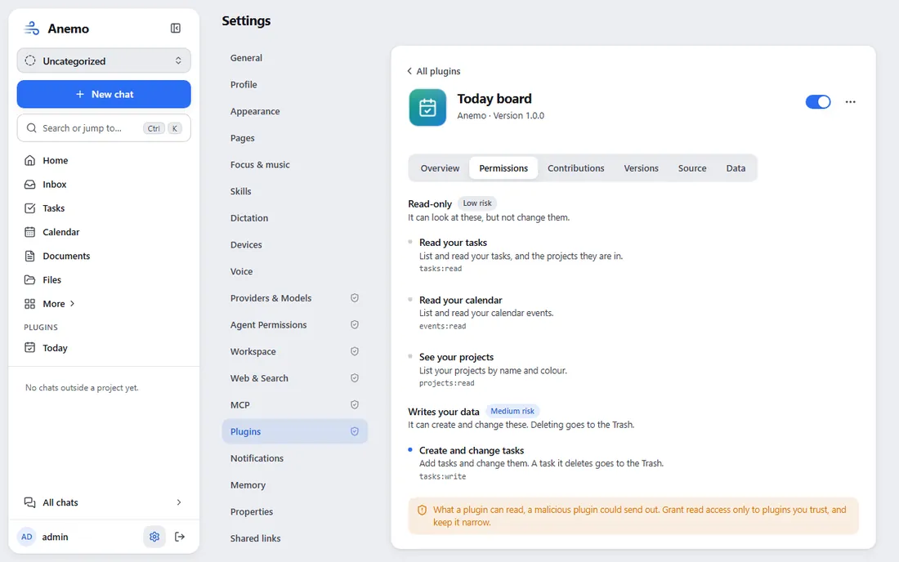
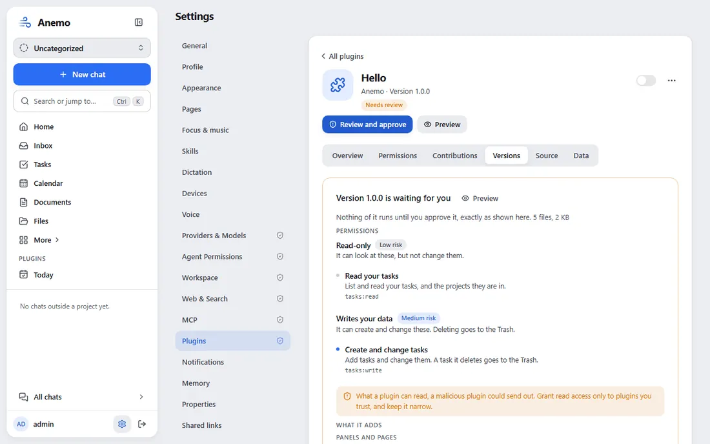
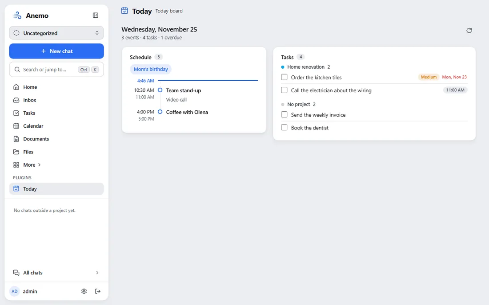
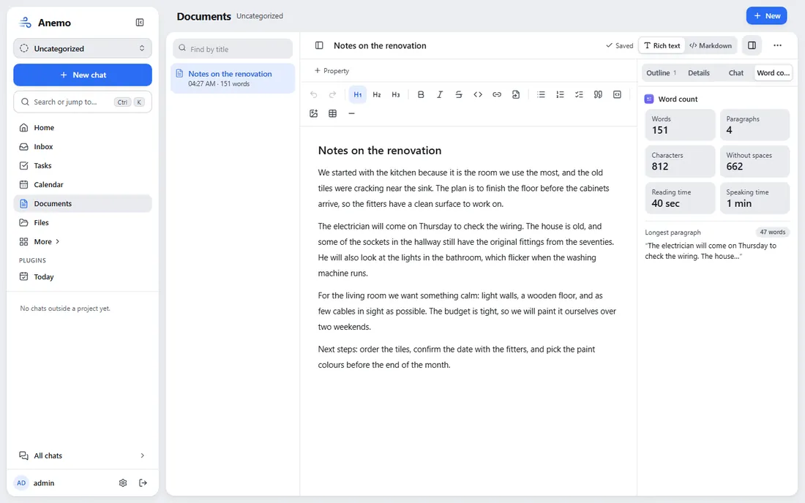
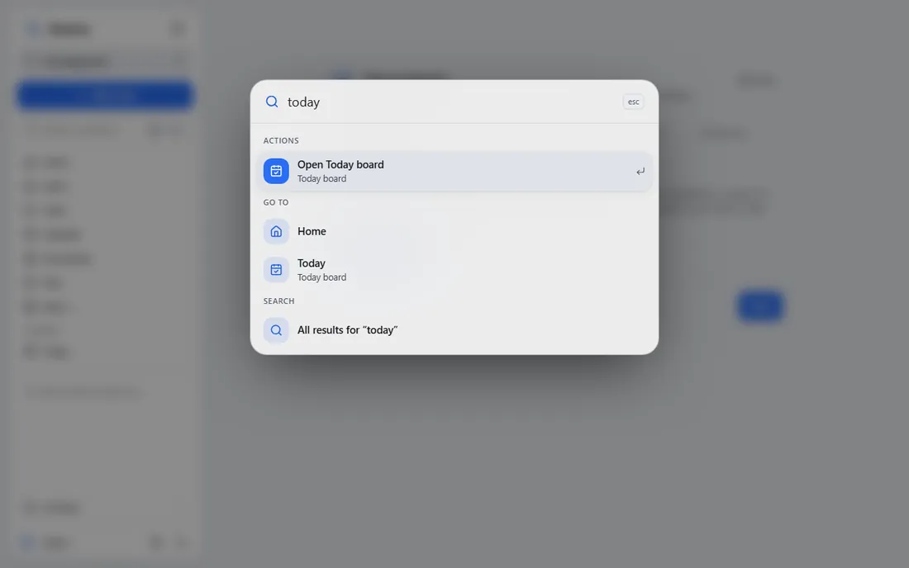
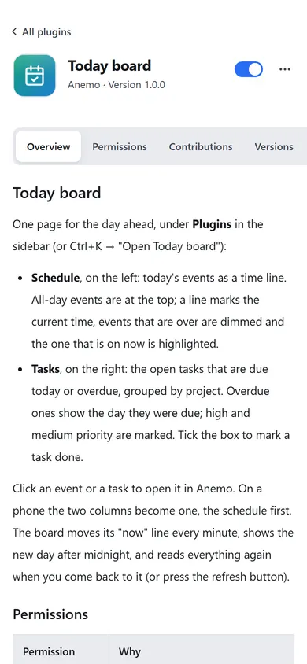
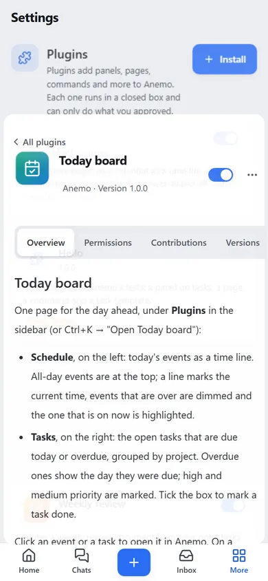

# Plugins

Status: built in `feat/plugins` (one PR); §8 says what was settled while building. The contract a plugin is written against is
`CONTRACTS-plugins.md`; this file says what plugins are for, how the design came about, the
security model, and how the round was split. Where the two disagree, the contract wins.

## 1. Goal

Anemo becomes extendable by its user, and by the assistant on the user's behalf: a plugin can
add a panel to tasks, documents or events, a page, a renderer for a kind of block in chat
answers, command-palette actions, and ready-made things Anemo already understands
(properties, saved views, templates, automations, scripts, MCP servers, agent profiles,
skills, themes). A marketplace comes later; the package format is designed for it now (a
stable id, semver versions, one manifest, a folder or zip, a content hash per version).

## 2. The design in one paragraph

A plugin is a **package** (a folder with `anemo-plugin.json`) that the server stores per
version with a hash of every file. It contributes in three layers. **Declarative**
contributions are data that Anemo turns into its own objects when the user approves a
version. **Logic** runs only where Anemo already runs untrusted logic: scripts in the Deno
sandbox of spec 08 and MCP servers in the mcp-host container or remotely; never in the API
or worker process. **UI** runs in sandboxed iframes with an opaque origin and a CSP that
blocks every network request, placed in four named slots; the iframe talks to Anemo only
through a `MessagePort` the host hands it, with a small request/response API. Every call
is checked in the page and again on the server, where it is carried out as an existing
agent tool through the policy engine, with the plugin as the actor (`plugin:<id>@<version>`).
What a plugin may do is the list of permissions in its manifest, shown at install and
granted only when the user approves that exact version with their password; an update that
changes anything stays pending while the old version keeps running. An assistant can build
a plugin end to end inside Anemo, but its work always lands as a pending version the user
reviews; it can't approve, enable or grant.

## 3. Decisions and why

| Decision | Alternatives considered | Why |
| --- | --- | --- |
| **UI in sandboxed iframes, opaque origin** (`sandbox="allow-scripts"`, no `allow-same-origin`) | A second origin (`plugins.<host>`); Web Components / JS in Anemo's page; a declarative UI DSL | Anemo is one origin behind the user's proxy: a second origin needs DNS, a certificate and proxy config per install. An opaque origin gives the same isolation (no cookies, storage or DOM of Anemo) with zero setup. JS in Anemo's page would see the session; a DSL is safe but can't express "a custom layout" without becoming a UI framework we'd maintain forever. |
| **The frame gets its code from the host, not by URL** | Serve plugin files to the frame from `/api/plugins/...` | An opaque-origin frame's requests to Anemo carry no cookie (cross-site), so they would need unauthenticated plugin-file routes or capability URLs. Handing the files over the port lets the CSP say `connect-src 'none'` and `default-src 'none'`: the frame reaches no server at all. |
| **One fixed frame document** (`/api/plugin-frame`) with the CSP in a response header including `sandbox` | `srcdoc` with a `<meta>` CSP | A `srcdoc` frame inherits the parent page's CSP, so a future CSP on Anemo would break or loosen plugins; a header with `sandbox` keeps the document sandboxed even when opened directly. |
| **A `MessagePort` per frame** | `window.postMessage` with origin checks | Every sandboxed frame's origin is `"null"`, so origin checks can't tell frames apart. The port is handed only to the frame Anemo created; a document the frame navigates to doesn't get it. |
| **Calls run as existing agent tools** | A parallel "plugin API" with its own service calls | One permission engine, one set of risk rules, one place for provenance and the change list; a fix to a tool fixes plugins too. The method → tool table (contract §4.3) is the only plugin-specific mapping. |
| **The plugin's own policy, not the agent permission levels** | Apply Settings → Agent permissions to plugins | Those levels describe how much a *model* may do unattended; a plugin's reach was decided by the user at review. Critical capabilities stay per-call approval either way. |
| **Approvals for UI calls in Anemo's page, with a one-time token** | The run approvals table | Approvals there belong to runs (`approvals.run_id`, `tool_call_id` are required). A UI call has a user looking at it, so a synchronous confirmation is the honest model; the token is bound to the exact call and never reaches the frame. |
| **Scripts and MCP for logic** | WebAssembly or JS in the worker; a plugin's own container | Both sandboxes exist, are reviewed and documented (security.md), and already route every action through the policy engine. A new sandbox is a new attack surface. |
| **Approve per version, all or nothing, with the password** | Per-permission toggles; auto-apply updates that don't add permissions | One reviewed thing (the package hash) is what runs: simple to reason about and what a marketplace signature will cover. A code change can be as dangerous as a new permission, so every update is reviewed; for an upload the review is the next screen, so it costs one click. |
| **Settings → Plugins, shield section** (not its own page in the sidebar) | A top-level Plugins page | Installing and approving plugins is configuration with the same weight as MCP servers (re-auth, security log); the sidebar is for daily work. Plugin *pages* do appear in the sidebar, under their own group. |
| **Templates and command actions exist only as plugin contributions in v1** | Build general document/task templates first | They are small and the examples need them; a general templates feature can reuse the same model later (roadmap). |

## 4. Security model

What the user is protected from, and how:

| Threat | What stops it |
| --- | --- |
| A plugin reads Anemo's session, cookies or tokens | Opaque origin; no `allow-same-origin`; plugin code never runs in Anemo's page; tokens and confirm tokens never enter the frame. |
| A plugin sends data it read to a server | CSP `default-src 'none'`, `connect-src 'none'`, images and fonts only `data:`/`blob:`, no forms, popups or nested frames. Network access is only `http.fetch` through the server to a host the user granted (`network:<host>`). See *limits* below. |
| A plugin does more than it declared | The server checks every call against the **approved** manifest, then the policy engine evaluates the tool's actions with the plugin's policy (allow only what's covered, ask for critical, deny the rest). |
| A plugin controls a device, shell or computer without the user knowing | Those capabilities are *critical*: every call asks in Anemo's own dialog; no "for this run" or "always". |
| An update adds permissions or changes code quietly | New versions are pending; the old approved version keeps running; approving needs the password and the hash of the exact version reviewed. |
| An assistant (possibly steered by a web page) builds a malicious plugin | It lands disabled as `needs_review`, marked "made by the assistant" with a link to the chat; the user reviews manifest, permissions and code; the agent tools can't approve, enable or grant. |
| A plugin steers an agent | Run-time output is data: plugin script results and MCP results reach models in `<untrusted_data>`; items last written by a plugin are labelled and wrapped when agent tools read them. Static, reviewed text (skills, profile instructions, automation prompts) is treated like code: reviewed once, then trusted. |
| A model's answer steers a plugin (`chat.block`) | The block text is untrusted input for the plugin; the frame can only do what its permissions allow, and confirmations are shown by Anemo. |
| A tampered file on the server | Files are checked against their recorded hashes when served and registered; a mismatch stops the plugin (`error`). |
| Something goes wrong across the board | The kill switch stops every plugin in the page and on the server at once. |
| Malicious package files (zip slip, huge files, SVG script) | Path rules, size and count limits, an allowlist of file types, pictures checked by content, no SVG. |

**Limits (written in security.md too).**

- The browser can't stop a sandboxed frame from **navigating itself** to another address,
  and an address can carry data. Anemo removes a frame the moment it navigates (and says
  so on the plugin's page), but the first request has left. WebRTC is not covered by CSP
  either; the bootstrap removes `RTCPeerConnection` before plugin code runs, which is a
  speed bump, not a wall. So: **what a plugin can read, a malicious plugin could send
  out.** Read permissions are therefore listed with this sentence in the review, and the
  real controls are the review of the code and keeping read permissions narrow.
- Plugin scripts run in Deno inside the worker container (spec 08's accepted risk).
- A `stdio` MCP server runs a program whose code is not in the package (e.g. `npx …`);
  it is marked critical in the review for that reason.
- Single user: "the user approved it" is the whole trust model.

## 5. Workstreams (phase 1, in parallel) and what each delivers

Each works in its own worktree branched from `feat/plugins`, follows CLAUDE.md, writes
tests, and doesn't touch the other workstreams' files (contract §9).

**A. Runtime and backend** (`feat/plugins-runtime`)
- Tables (migration `0079_plugins`): `plugins` (id, plugin_id unique, enabled, source jsonb,
  approved_version_id, error, created_by), `plugin_versions` (plugin, version, number,
  manifest jsonb, files jsonb {path: {sha256, size}}, hash, status, created_by,
  approved_at), `plugin_resources` (plugin, kind, item id, object type, object id, owned),
  `plugin_storage` (plugin, key, value jsonb), `plugin_chats` (plugin, conversation).
  Files under `<DATA_PATH>/plugins/<plugin id>/<package hash>/`.
- `manifest.py` (Pydantic models of the manifest, the validation rules, error messages
  meant for the user and for an assistant), `package.py` (zip and folder reading with the
  file rules, hashing, Git fetch), `permissions.py` (the list, risks, explanations, the
  coverage table, `policy_for(manifest)`), `registry.py` (create/update/remove the
  declarative contributions in their own services; ownership rows), `calls.py` (method →
  tool, the checks of §6.4, confirm tokens in Valkey, rate limit, audit), `service.py`
  (install, approve, reject, enable, uninstall, kill switch, diff), `router.py`, the frame
  route, the `plugin` actor kind and its `describe()` label, the untrusted-wrapping of
  plugin-written items in the read tools, plugin MCP tools forced to ask, plugin scripts
  and automations switched with the plugin.
- Tests: package rules (zip slip, sizes, types), manifest validation, install → approve →
  enable → call → disable, update stays pending, permission enforcement on every method,
  critical → confirm_required, token single-use, kill switch, uninstall keep/remove, Git
  install with a faked fetch, provenance, audit entries.

**B. Plugin management UI and the host** (`feat/plugins-ui`)
- Settings → Plugins: the kill switch, a grid of plugin cards (icon, name, description,
  version, enabled switch, badges), the install flow (zip, Git URL, bundled examples) with
  the permission review, the detail page (readme, permissions grouped by risk with plain
  explanations, contributions, versions with the diff of a pending update, source and
  chats, data it stores, enable/disable, approve, reject, uninstall with keep/remove,
  "Continue building with the assistant", "Preview", its `settings` slot).
- The **card → detail transition**: the card is the shared element and grows into the
  page (View Transitions API with `view-transition-name` on the card and the page header,
  FLIP with `motion` as the fallback); reversed on Back; nothing animates under
  `prefers-reduced-motion`; on phone widths the detail page is a full-screen sheet that
  grows from the card. No layout jump, no flash of the wrong content (the detail's data is
  in the query cache from the list before the transition starts).
- The host: `PluginFrame` (creates the iframe, the handshake, the port, the call queue,
  rate limits, confirmations, resizing, theme and context events, removal on navigation),
  the frame bootstrap and base CSS, and the slot mounts: object panels in `TaskDialog`,
  `DocumentInfo` (a tab per panel), `EventDialog`; plugin pages at `/plugins/:id/:ui` with
  sidebar and Ctrl+K entries; `chat.block` through a fence-renderer registry in `lib/` that
  `Markdown` consults (shared code can't import features); plugin commands in Ctrl+K.
- Follows PR #86's `SettingRow`/`SettingRows`/`Card`, the density tokens and the `.glass`
  look; all text through `t()` with Ukrainian and Russian; vitest tests.

**C. Agent tooling** (`feat/plugins-agent-tools`)
- The tools of contract §8 with descriptions written for a model, the `plugins.build`
  capability, the authoring guide (`guide.md`: the plugin-facing contract as a tutorial,
  the object shapes, the SDK, worked examples, common validation errors), the
  "Continue building with the assistant" chat (linked to the plugin, Agent mode, the plugin
  tools available, a first message that names the plugin), and tests with the fake model.

## 6. Phase 2 (orchestrator)

Merge A, B, C; build the bundled examples against the real implementation, using only the
contract:

1. `anemo.word-count`: an `object.panel` on documents (`documents:read`) with words,
   characters, reading and speaking time, and the longest paragraph.
2. `anemo.today-board`: a `page` that lists today's tasks and events in a two-column
   timeline layout (`tasks:read`, `events:read`, `tasks:write` to tick a task off), with a
   command "Open Today board".
3. `anemo.weekly-review`: a `script` (lists open tasks and the week's events, writes a
   review document) + a document `template` + commands "Run weekly review" and
   "New weekly review from template" (`tasks:read`, `events:read`, `documents:write`).

Then all frontend and backend checks that run here, screenshots of the card → page
transition at desktop and phone width, docs (features, security, roadmap), the
orchestration log and the PR.

## 7. Done when

1. A zip, a Git URL or a bundled example installs as `needs_review`; nothing of it runs or
   shows until approved with the password; approving with a stale hash is refused.
2. An approved, enabled plugin's panel shows on documents/tasks/events, its page in the
   sidebar and Ctrl+K, its commands in Ctrl+K, its fence in chat answers.
3. A frame has no access to cookies or the network (sandbox + CSP verified by headers and a
   test of the frame document), and talks only over its port.
4. Every method is refused without its permission, in the page and on the server; a
   critical tool call asks every time; writes carry `plugin:<id>@<version>` and are in the
   security log.
5. An update stays pending (old version runs) until approved; the diff shows manifest,
   permissions and files.
6. An assistant can create and change a plugin with the tools, never approve or enable it;
   the plugin's page shows the chat and continues it.
7. Disable, uninstall (keep / remove data) and the kill switch behave as in contract §5.
8. The three examples work using only the contract.

## 8. As built

Settled while building (the contract records each in place, and §7 lists the HTTP side):

- Reads are checked as their tool's call and then read the same data as JSON; writes run
  the tool. A tool's own "dangerous" actions (`delete_task`) ask even when the permission
  is granted.
- The host answers `context.get` and `ui.*` itself; the server refuses them.
- `init.timeZone` (the user's Settings → General zone), because a frame's "today" (the
  browser's) and the server's could differ; the *Today board* uses it.
- `tasks:read` covers listing projects, in the page and on the server.
- A plugin script's calls follow the user's agent permission levels on top of the
  plugin's coverage, so with the defaults the *Weekly review* asks before writing its
  document. Kept on purpose: a script runs unattended.
- Removing a plugin's data switches its automations off at once and deletes them with a
  background job (as `delete_schedule` does), so the tools layer doesn't import the
  agent runtime.
- The document side panel shows a plugin panel as a tab; tasks and events show panels
  under their details.

Where the files are: `backend/app/features/plugins/` (`manifest.py`, `package.py`,
`store.py`, `permissions.py`, `registry.py`, `calls.py`, `shapes.py`, `service.py`,
`router.py`, `frame_router.py`, `frame/`, `bundled/`, `guide.md`, `chat.py`),
`backend/app/tools/builtin/plugins.py`, `frontend/src/features/plugins/` (`host/` is the
frame host), migration `0079_plugins`.

| | |
| --- | --- |
| Settings → Plugins  | The card on its way to the page  |
| The plugin's page  | Permissions by risk  |
| A plugin waiting for review  | *Today board*, a plugin page  |
| *Word count* beside a document  | Plugin commands in Ctrl+K  |
| Phone: the page as a full-screen sheet  | Phone: mid-transition  |

The transition as a sequence (frames taken at a tenth of the speed):
[desktop, open](12-plugins/transition-desktop-open.webp),
[desktop, back](12-plugins/transition-desktop-back.webp),
[phone, open](12-plugins/transition-phone-open.webp).

## 9. Not in this round

- A marketplace, signatures, automatic update checks.
- Optional (per-item) permissions; plugin tools implemented by scripts (contract §2.3).
- Plugin slots in other places (the editor's blocks, the home widgets, the run timeline),
  plugin keyboard shortcuts, localisation of plugin texts.
- e2e (Playwright with Docker) isn't available on the VM this was built on; see the PR.
