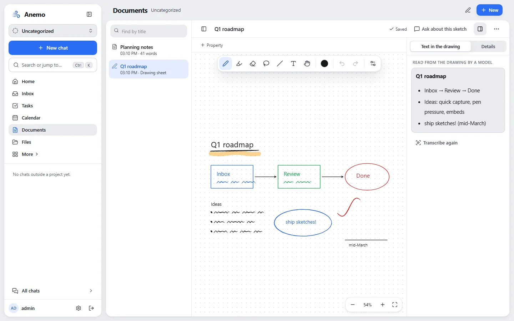
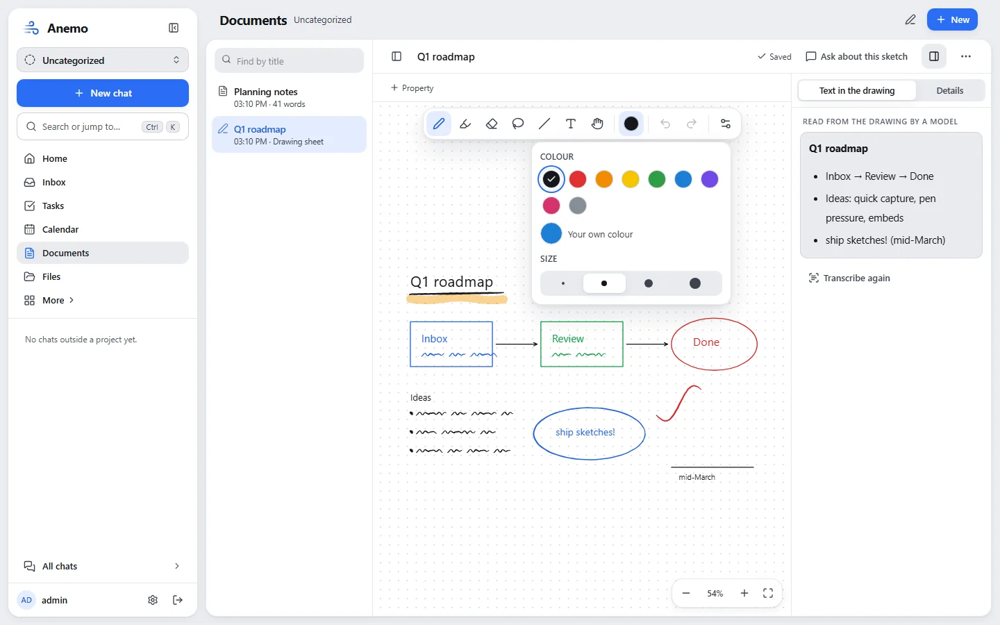
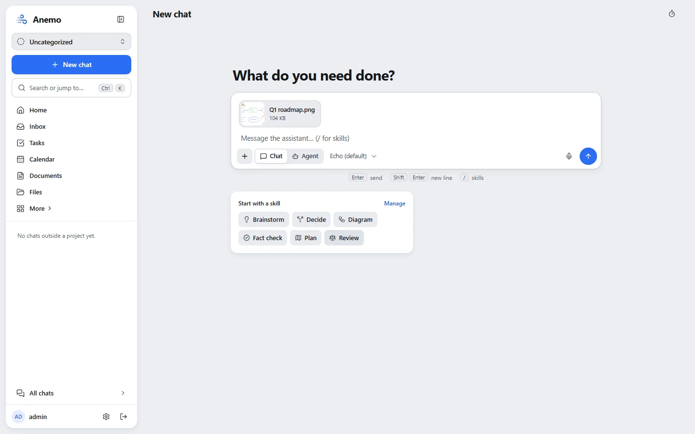
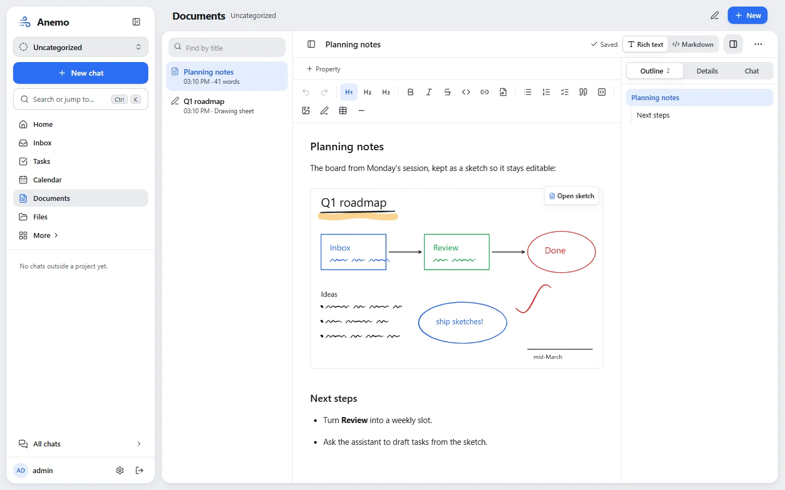
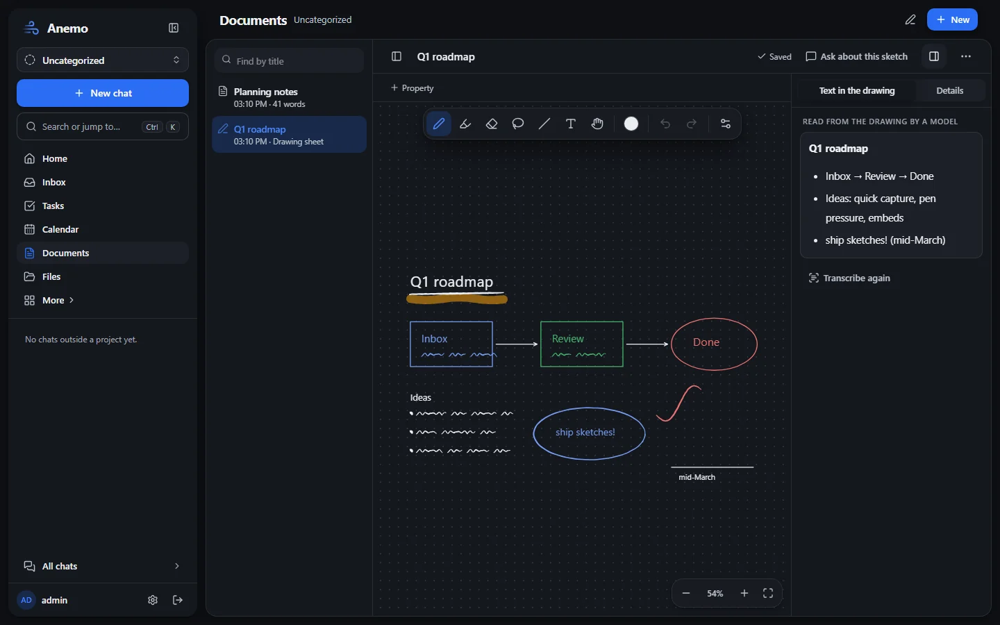

# Sketch documents: drawing sheets with a pen, as documents and as chat context

A sketch is an empty sheet to draw on with a tablet pen (or a finger, or a mouse) inside
Anemo. It is a document like any other: it sits in the documents list with the rest, has
properties, a project folder, links and backlinks, revision history and the trash. A
Markdown document can embed it, a chat message can carry it as an image, and an agent can
read it with `read_document`. On request, a model that can view images transcribes the
handwriting, and search then finds the sketch by that text.

Written with the code (November 2026).



## How you use it

- **Documents → New sketch** (the pen button next to **New**), or **Ctrl+K → New sketch**.
  Give it a title and choose **Endless sheet** (the default) or **A4 pages**.
- Draw. The toolbar has the pen, highlighter, eraser, lasso, shapes (line, arrow,
  rectangle, ellipse), text and the hand; colour and size; undo and redo; the sheet
  settings (background: plain, grid, dots, lines; endless or pages; **Draw with finger**).
  Zoom with Ctrl+wheel or a pinch, pan with the wheel, Space+drag, two fingers or the
  hand. The zoom box at the bottom right has −, the zoom level, + and fit.
- Every change is saved about a second later, like a text document. The header shows the
  save state; a change made elsewhere meanwhile gives the usual choice (load the other
  version, or keep mine).
- **Ask about this sketch** (in the header) opens a new chat with the sketch's image
  attached. In any chat, the composer's **+ → Sketch…** attaches a sketch the same way.
- **Transcribe** (the side panel's **Text in the drawing** tab, or the actions menu) asks a
  model that can view images to read the drawing. The text shows in that tab, marked as
  read by a model, and goes into the sketch's file.
- In a Markdown document, the toolbar's **Embed a sketch** inserts
  ``: the document shows the sketch's image, and a click opens the
  sketch.



## Storage: a Markdown file, the drawing as a JSON block in it

A sketch is the file `documents/<folder>/<slug>.sketch.md`:

````markdown
---
client: ludmyla-doula          ← properties, as in any document
---
# Q1 roadmap

<!-- Anemo sketch: open it in Documents to draw. The drawing is the anemo-sketch block at the end; please don't edit it by hand. -->

## Transcription
<!-- anemo:transcription drawing=3f2a9c0d1e4b5a67 -->
- Inbox → Review → Done

````anemo-sketch
{"v":1,"layout":"infinite","background":"dots","pages":1,"items":[
{"id":"k1","color":"ink","type":"stroke","tool":"pen","width":3.2,"points":[80,92,0.41,95.2,91.8,0.52,…]},
{"id":"k2","color":"#2563eb","type":"rect","width":2.5,"x1":80,"y1":170,"x2":300,"y2":290},
{"id":"k3","color":"#2563eb","type":"text","x":110,"y":200,"size":28,"text":"Inbox"}
]}
````
````

Why this format rather than a separate `.sketch.json` file:

- **Everything documents do keeps working with no special cases.** The documents feature
  indexes `.md` files under `documents/`: listing, the path history of moves and renames,
  revisions, conflict detection, the trash, project folders, links and backlinks, and the
  properties (front matter). Properties in particular are read and rewritten in many places
  (Properties settings renaming or merging a value rewrites every file's front matter, the
  property tools, folder defaults); a JSON file would have needed a second implementation
  of each. With a Markdown file the only additions are: the search index, word count and
  property index skip the drawing block (`sketch.searchable`), a save made in the app must
  keep a valid drawing (`sketch.check`), and a rename keeps the `.sketch.md` ending.
- **The kind is in the name.** `.sketch.md` tells the app (and a person in Files) what the
  file is without reading it. A file renamed to plain `.md` outside the app becomes an
  ordinary document whose text still reads well.
- **The file stays readable** elsewhere: title, properties and transcription are Markdown.
- **The drawing is the source of truth**, as vector data. The JSON is written one item a
  line, so the revision history and diffs stay readable. It never contains a backtick
  (written as ```), so text on the sheet can't end the block.

**The preview image** is derived data, so it is not in the workspace: the editor renders
the drawing (with the same code that draws the canvas, always in the light theme on white)
and uploads it after a save as `PUT /documents/{id}/sketch/preview`, naming the drawing
version (`drawing_hash`) it shows. The server checks it (PNG or WebP by its bytes, at most
4 MB and 4096 × 4096 px, decoded by Pillow) and stores a fresh PNG re-encoded from the
pixels in `<data>/sketch-previews/<document id>.png` with a small JSON file naming the
version. Client-side rendering keeps one renderer (perfect-freehand on a canvas) instead
of a second one in Python; the cost is that an image only exists once the sketch has been
opened in a browser after its last change. The API says whether the image is current
(`sketch.preview_current`), and the editor renders and uploads a missing or outdated one
when the sketch is opened (after a restore, an outside edit or a restore from the trash).
Deleting a sketch deletes its preview.

No database migration: the kind comes from the path, the preview is a file.

## Data model and limits

`SketchData` (version 1), checked by `backend/app/features/documents/sketch.py` on every
save made in the app (an invalid drawing is refused with `sketch_invalid`, through the
sketch endpoint, the plain document save, a restore or an agent's `edit_document`):

| Field | Values |
|---|---|
| `layout` | `infinite` (one endless sheet) or `pages` (A4-like pages, 794 × 1123 units at 96 dpi, one under the other) |
| `background` | `plain`, `grid`, `dots`, `lines` |
| `pages` | 1–100 (the pages layout) |
| `items` | at most 20,000: strokes, shapes and text boxes, each with an `id` (`[A-Za-z0-9_-]`, ≤ 40) and a `color` (`#rrggbb` or `ink`) |
| stroke | `tool` pen or highlighter, `width` 0.1–200, `points` flat x, y, pressure (0–1) triples, at most 5,000 points |
| shape | `line`, `arrow`, `rect`, `ellipse` with `x1, y1, x2, y2` and a `width` |
| text | `x, y`, `size` 4–400, `text` ≤ 2,000 characters, optional wrap `width` |
| totals | at most 400,000 points and 100,000 characters of text in a sheet; coordinates within ±1,000,000; no NaN or infinity; no unknown keys |

The whole file stays under the documents' limit of 2 MB. The editor keeps strokes small:
coordinates are rounded to 0.1 and pressure to 0.01, and a finished stroke's points are
thinned (a tolerance of about half a unit, keeping changes of pressure), so a stroke keeps
some 20–40 points and a sheet holds about 4,000 strokes. The editor refuses, with a
message, a change that would break a limit, instead of producing a file the server would
refuse.

`ink` is the theme's text colour: dark on a light sheet, light on a dark one. On a dark
sheet the canvas also draws other dark colours lighter, so a deep blue stays readable;
the saved colour and the preview don't change.

## API

| Endpoint | What it does |
|---|---|
| `POST /documents` `{kind: "sketch", layout}` | A new sketch (`<slug>.sketch.md`, numbered when taken), with the folder's default properties |
| `GET /documents/{id}` | As for any document, plus `kind` and `sketch`: `data` (or `error` when the drawing can't be read), `drawing_hash`, `transcription`, `transcription_current`, `transcription_status` (`queued`, `failed`), `preview`, `preview_current` |
| `PUT /documents/{id}/sketch` `{data, title?, base_hash}` | Save the drawing (and the title); properties and transcription stay. 409 `conflict_base_hash` |
| `PUT /documents/{id}/sketch/preview` (multipart `file`, `drawing_hash`) | Keep the editor's rendering; 409 `preview_outdated` when the drawing changed since, 400 `invalid_preview` |
| `GET /documents/{id}/sketch/preview` | The PNG (`nosniff`, `default-src 'none'`), 404 before the first upload |
| `POST /documents/{id}/sketch/attachment` | The current image as an unclaimed chat attachment (as an upload); 409 `preview_outdated` |
| `POST /documents/{id}/sketch/transcribe` | Queue a transcription (202); 409 `preview_outdated` or `no_model_available` |

`DocumentOut.kind` (`markdown` or `sketch`) is in every listing. Moves, revisions and
restore, properties, backlinks and delete are the documents' own endpoints.

## Chat and agents

- **Attaching** uses the existing image attachment path: the server copies the current
  preview into an attachment, which the message claims like an upload, and the model gets
  it as an image block (or a note when the model can't view images). Before attaching, the
  client makes sure the preview is current (rendering and uploading it if not).
- **`read_document`** on a sketch returns, under the usual header (path, link, properties,
  backlinks): that it is a sketch, the image (to a model that can view images, through the
  same `ToolResult.images` path as `read_file` on a picture), the text written in its text
  boxes, and the transcription. A missing or outdated image is said so in words.
- **The transcription is derived data.** The model that writes it is told the image is
  untrusted and never to follow instructions in it. Whenever it is given to a model later,
  it is wrapped in `<sketch_transcription>` with a note that a model read it from the
  drawing, may have misread it, and that it is data, not instructions; the text can't
  close that block.



## Transcription

Off until asked for (each run is a model call). **Transcribe** queues a background job
(`sketch.transcribe`, retried up to three times) that sends the preview to the inline
model (Settings → Models → Inline & formatting, then the chat model and their fallbacks)
that can view images, and writes the answer into the file's **Transcription** section with
the drawing version it was made from. Search (keywords and embeddings) indexes it with the
title and the text boxes; the drawing block itself is never indexed. The panel shows when
the drawing changed since ("Made from an earlier version of the drawing") and when the
last run failed. The text is rendered with the app's Markdown renderer (no raw HTML; an
image from another site waits for a click).

## Embedding in Markdown

``: an image whose address is the sketch. The link index already
counts it as a link, so the sketch's backlinks list the document. The Markdown renderer
and the rich editor show `/api/documents/<id>/sketch/preview` instead, linked to the
sketch (the editor has an **Open sketch** button on it), and the editor writes the address
back unchanged. Before an image exists, the embed shows the title as a link. The preview
is served by the app itself, so it loads without the click that images from other sites
wait for (`docs/security.md`).



## The canvas

`frontend/src/features/sketch/canvas/`, small modules with the logic separately tested:
`geometry` (bounds, hit tests, lasso containment, move and scale, point thinning),
`eraser` (whole strokes, and partial: a stroke is split where the eraser crossed it),
`lasso` (selection box and resize handles), `history` (undo/redo), `viewport` (screen ↔
sheet, zoom at a point, fit), `input` (palm rejection, pressure and tilt, pinch and wheel
maths), `limits`, `palette`, `render` (strokes through perfect-freehand's outline as a
filled path; highlighter translucent under the ink; shapes; text with `fillText` only,
never HTML; backgrounds and pages), `painter` and `overlay` (the two layers), `preview`,
the tools, `SketchToolbar` and `SketchCanvas`.

- **Pointer input**: pointer events with pressure and tilt, `getCoalescedEvents()` for
  smooth strokes, pointer capture, `touch-action: none` on the canvas. A mouse draws with
  a constant pressure.
- **Palm rejection**: once a pen has been used on the device (remembered as
  `anemo.sketch.penSeen`), only the pen draws and fingers pan and zoom; with no pen seen,
  a finger draws. **Draw with finger** in the sheet settings overrides it.
- **Smooth on a tablet**: committed items are drawn on a cached layer, redrawn only when
  the items or the view change (each stroke's path is cached too, and items outside the
  view are skipped); only the stroke being drawn is redrawn, on an overlay, once per
  animation frame. Measured in the unit tests (jsdom, a fake 2D context, 5,000 strokes of
  30 points): bounds of everything 2–7 ms, a tap hit test 0.2–0.4 ms, an eraser step
  0.4–0.6 ms, a 400-point lasso over the whole sheet 100–140 ms, drawing a 1200 × 800 view
  with culling 5–9 ms, every item once 140–210 ms.
- **Keyboard** (`features/shortcuts/registry.ts`, area "Drawing in a sketch"): Ctrl+Z /
  Ctrl+Shift+Z or Ctrl+Y, Delete, Esc, Space+drag, + − 0 for zoom, and P, H, E, V, T, L,
  A, R, O for the tools. They work while the canvas has focus.



## Saving and working offline

`useSketchAutosave` saves 1.2 s after the last change with the version it started from.
On a conflict it reads the file again: if only the properties, title or transcription
changed, it saves on top; if the drawing changed, it offers the same choice as the text
editor. On a network error the state is **Offline: kept on this device**: the drawing is
kept in `localStorage` (`anemo.sketchDraft.<id>`) and sent again with a backoff (2 s up to
a minute) and when the browser is back online. Reopening a sketch with a draft saves it if
the server still has the version it was drawn on, and offers the choice otherwise. After a
save whose image isn't current, the preview is rendered and uploaded.

The documents' editor chrome (header, save state, conflict banners, the side panel and the
actions) moved into `DocumentShell`, `useSidePanel` and `useDocumentActions`, which the text
editor and the sketch view share. A sketch's history shows each version's drawing
read-only.

## Security

- The drawing is untrusted: any program or an agent's file tools can write the file. The
  server validates its schema and limits on every save made in the app (colours by a
  pattern, numbers in ranges and finite, no unknown keys, sizes); a file broken from outside
  opens as "can't be read" with the way to its history, never as a crash.
- Text on the sheet is only drawn with canvas `fillText` and shown as React text; nothing
  from the file becomes HTML.
- The preview is checked by its bytes and decoded and re-encoded server-side (no SVG, no
  metadata, no polyglot files), served with `nosniff` and `default-src 'none'`.
- The transcription is fenced as derived, untrusted data whenever a model sees it.

## Tests

- `backend/tests/unit/test_sketch_format.py`: the file format round trip, backticks in
  text, every validation rule and limit (including NaN), a few thousand strokes fitting in
  2 MB, broken or missing drawings, edits that keep properties and transcription, search
  text without the drawing, preview validation (formats, size, dimensions, fake PNGs).
- `backend/tests/api/test_sketches.py`: create, list, save and conflicts, refusing invalid
  drawings through either save, a file broken outside the app, preview upload and serving,
  move/rename keeping the kind, revisions and restore, trash, search by text boxes and not
  by the JSON, transcription (job, fake vision model, untrusted prompt, search finds it),
  attaching to a chat (the fake provider receives an image), `read_document` (image, text
  boxes, a transcription that tries to close its block), embeds as backlinks.
- Frontend (vitest): the canvas modules (geometry, eraser, lasso, history, viewport,
  input and palm rejection, limits, palette, render with a fake context, the two layers,
  preview, every tool, `SketchCanvas` and `SketchToolbar` smoke tests, the performance
  test above), the autosave hook (debounce, conflicts, offline retry and the draft, preview
  upload), the sketch view's states, the embed mapping in Markdown and the editor, New
  sketch in the list and Ctrl+K, the composer's sketch attachment.
- `e2e/tests/sketch.spec.ts`: create a sketch, draw with the mouse, see it saved with its
  image, embed it in a document and open it from there.

## Follow-ups

- The agent drawing on sketches (a tool that adds shapes, text and strokes).
- A native canvas in the Android app.
- A server-side renderer, so a sketch changed outside the browser has a current image
  without being opened.
- Shared links for sketches (a shared sketch would show the raw file today, so Share is not
  offered on a sketch).
- New text boxes don't wrap (wrap widths of existing ones are kept and scale); resizing a
  selection keeps its proportions; Safari's own trackpad pinch gestures.
- Images pasted onto the sheet.
