# Documents sidebar: before and after

Playwright (Edge) against a local dev stack with the fake model and a purple accent, with
"Spec 26: document organisation" open. The list is 200, 260 and 400 px wide (the stored
`anemo.docList.width`); the phone is 390 px. Every shot is in `before/` and `after/`.

| | Before | After |
|---|---|---|
| 260 px, dark | 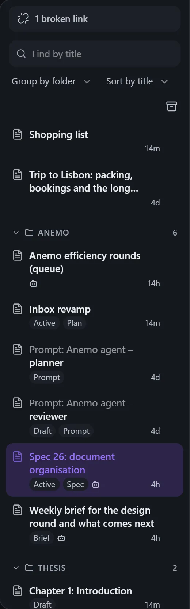 | 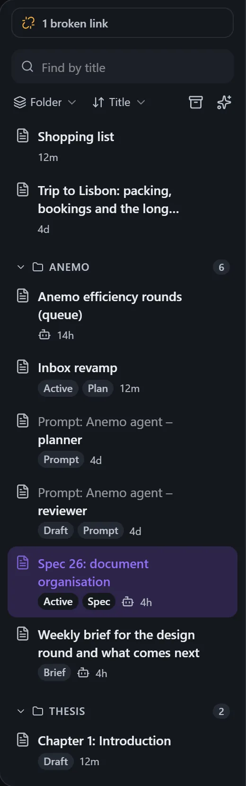 |
| 200 px, dark | 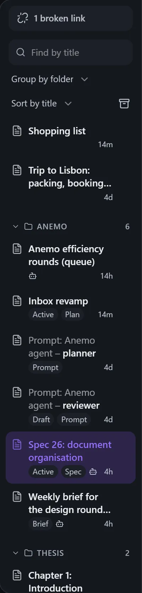 | 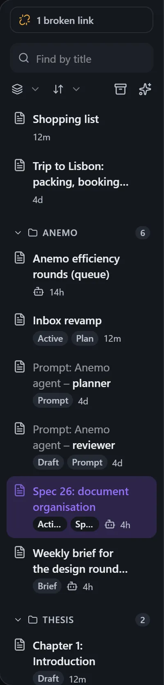 |
| 200 px, light | 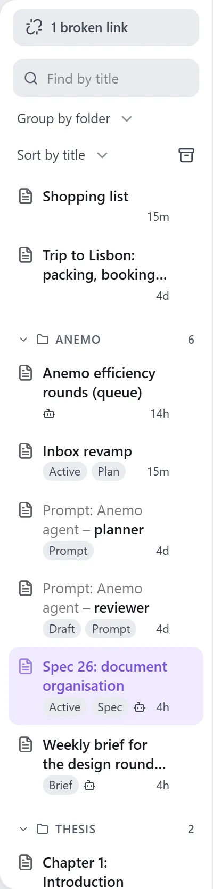 | 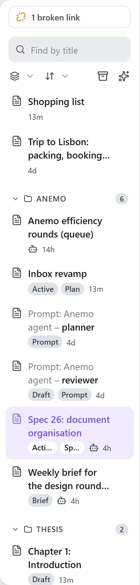 |
| 400 px, light | 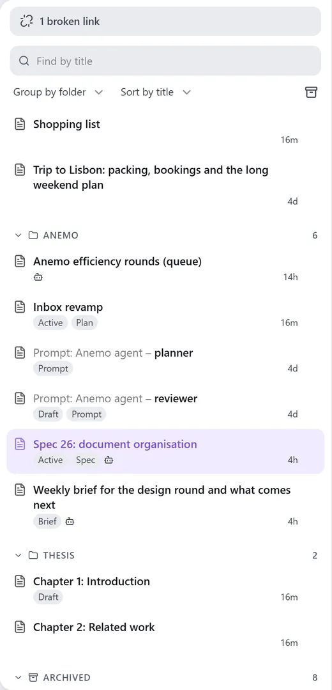 | 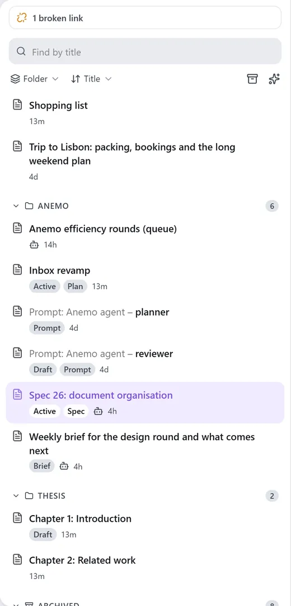 |
| 400 px, dark | 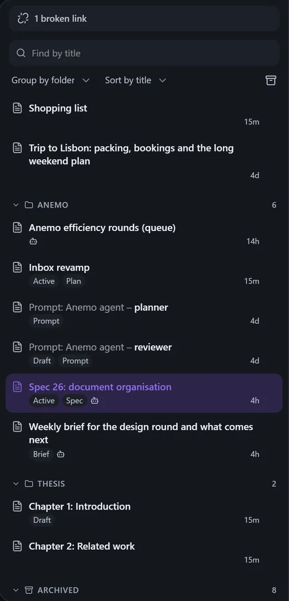 | 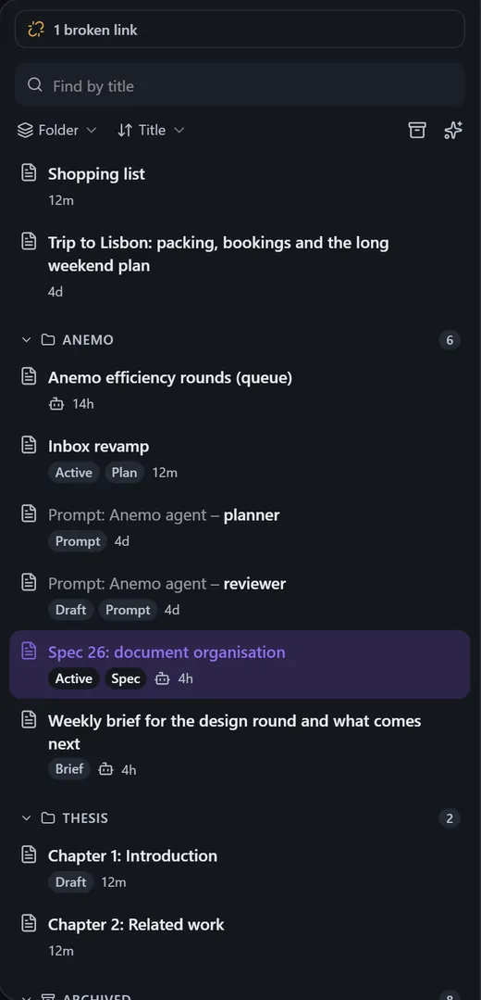 |
| Phone, light | 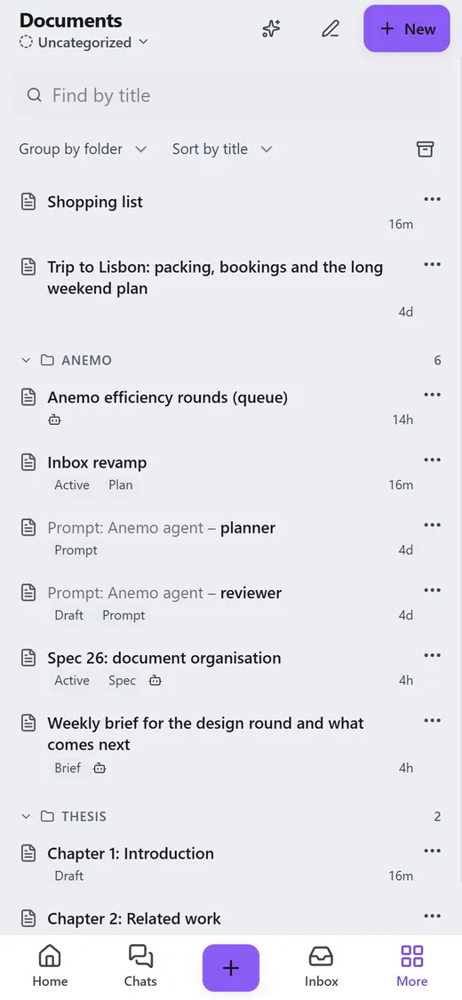 | 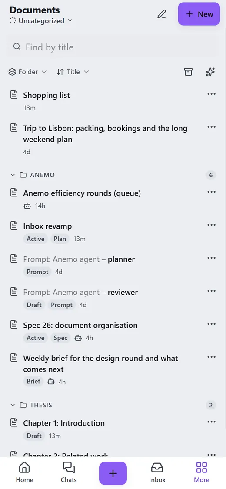 |
| Phone, dark | 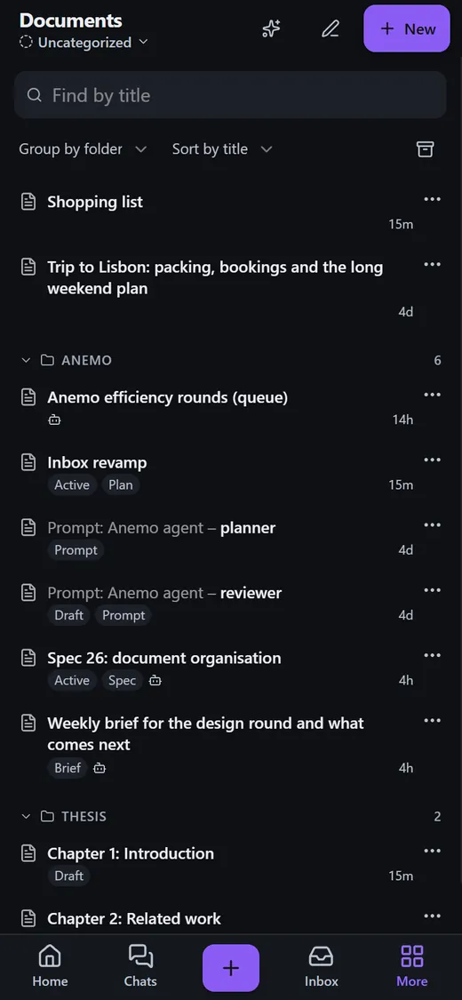 | 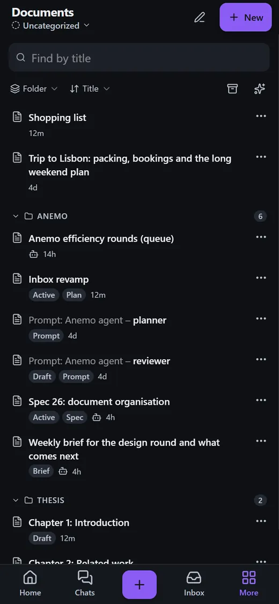 |
