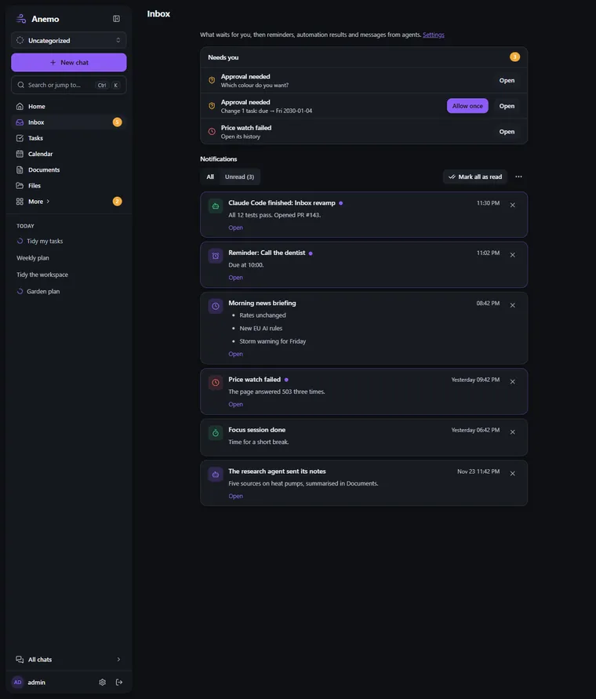
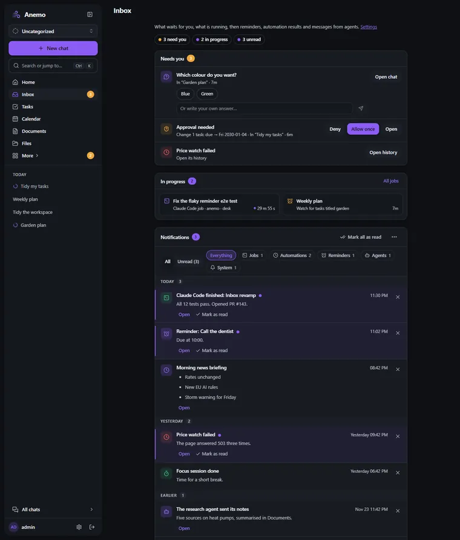
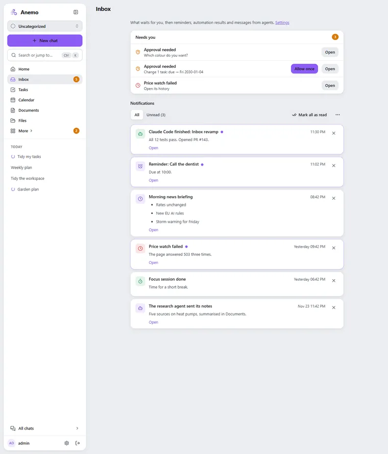
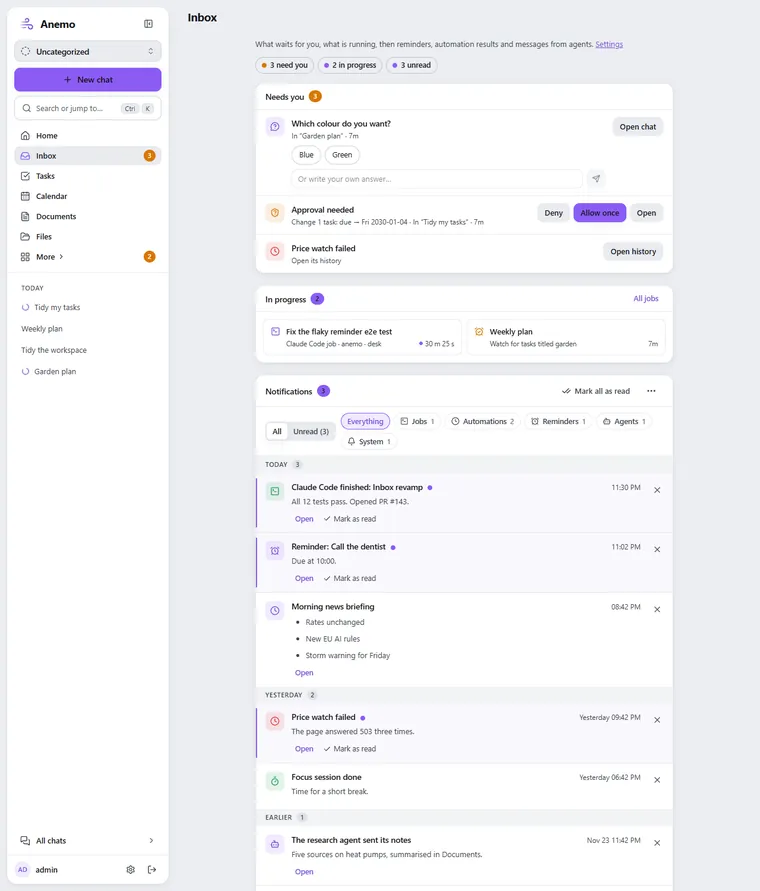
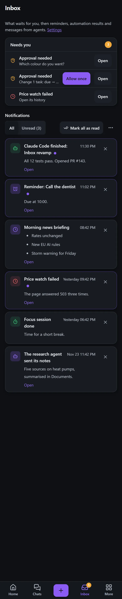
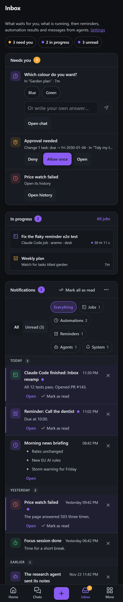
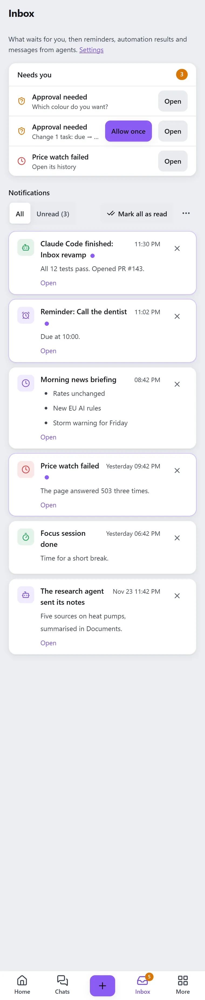
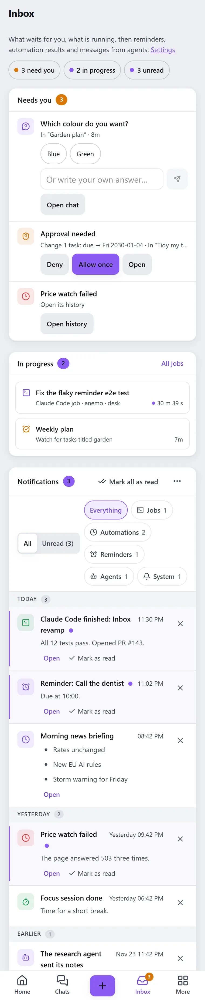

# Inbox revamp: before and after

Playwright (Edge) against a local dev stack with the fake model: a question from `ask_user`,
an approval (a task change), a failed automation, a running Claude Code job, a wake-me
trigger and six notifications over three days. Desktop 1280 px and phone 390 px, dark and light.

| | Before | After |
|---|---|---|
| Desktop, dark |  |  |
| Desktop, light |  |  |
| Phone, dark |  |  |
| Phone, light |  |  |
