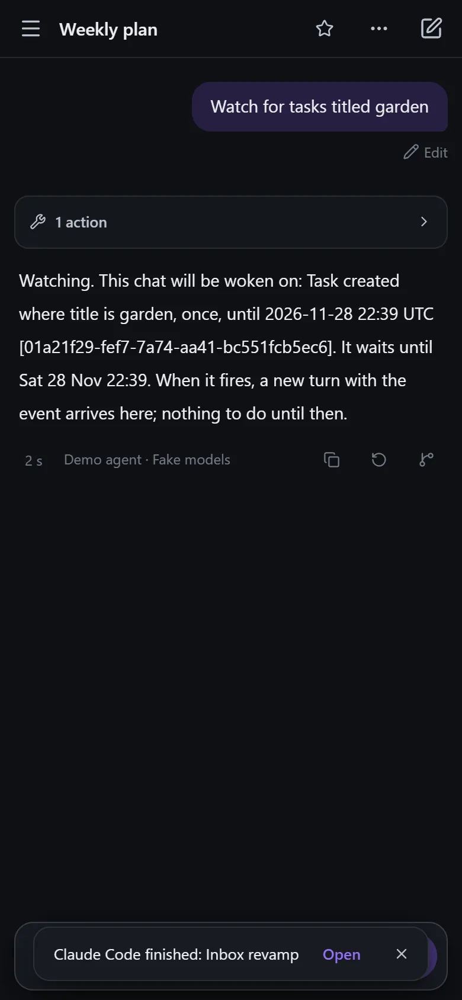
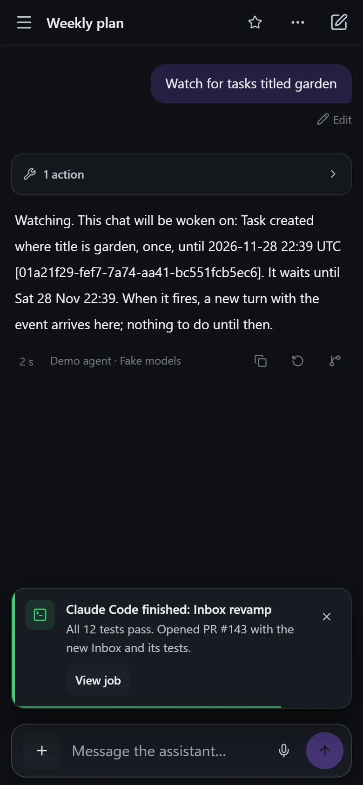
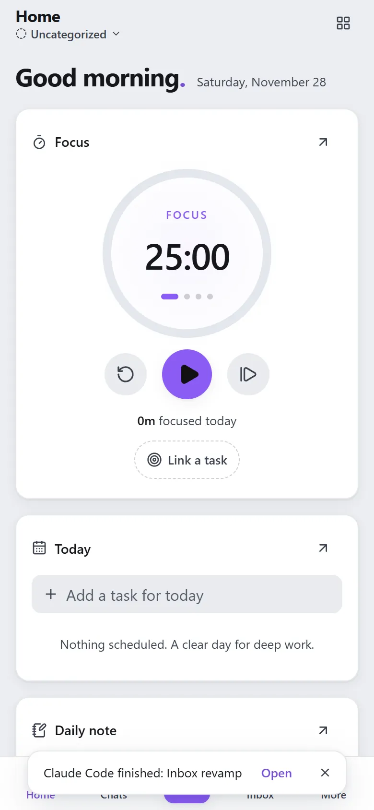
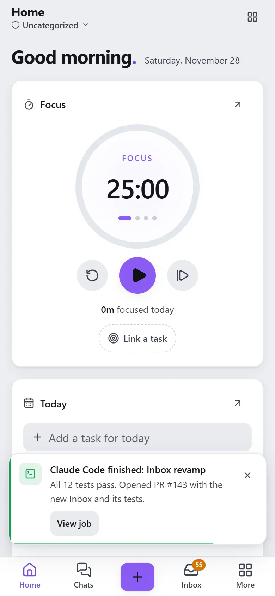
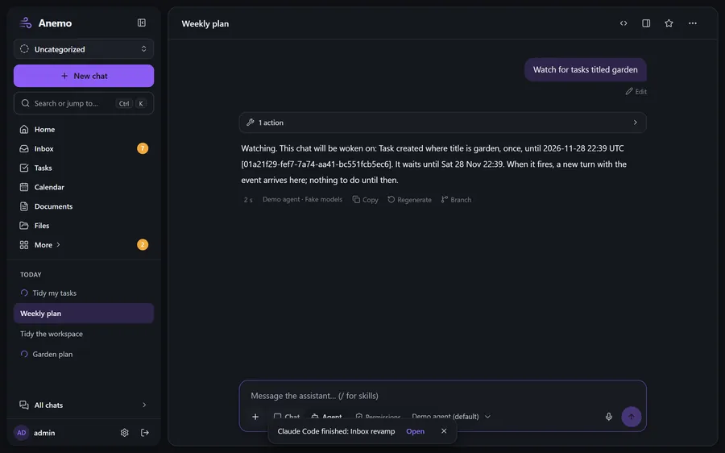
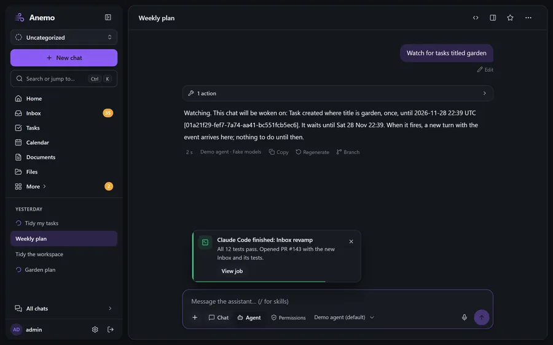
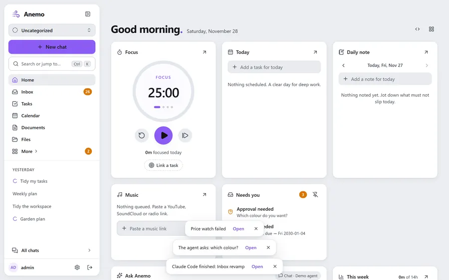
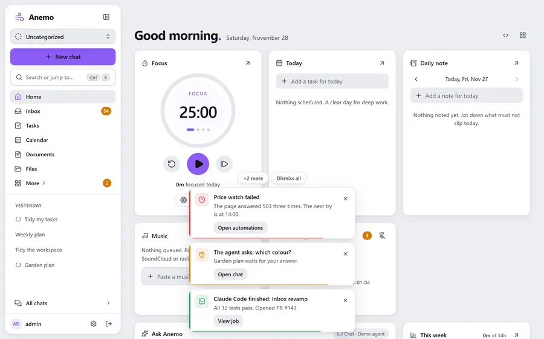
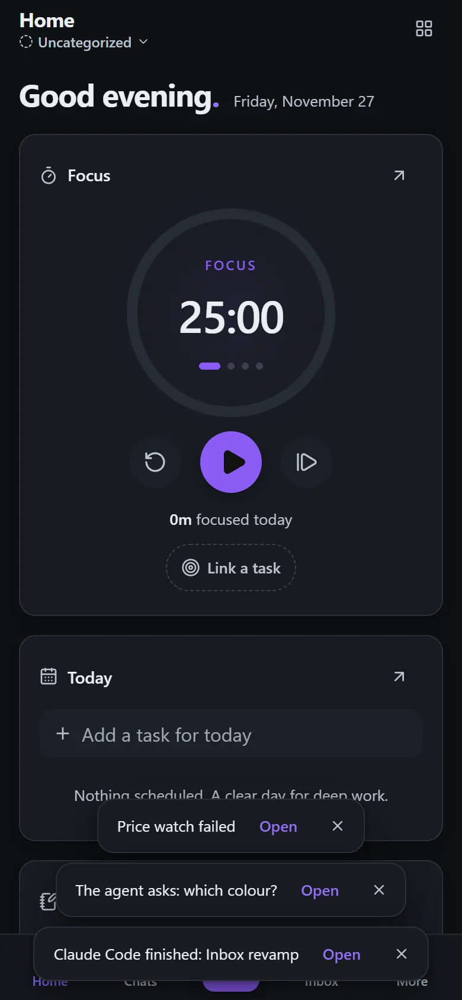
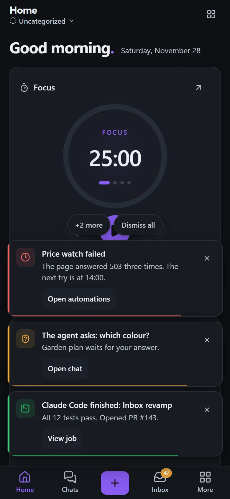

# In-app notification banner: before and after

Playwright (Edge), local dev stack; notifications created through the real service, so they
arrive by the app's event stream as in use. Desktop 1280 px and phone 390 px (2x), dark and
light; on Home, in a chat, and a burst of five (`burst`).

| | Before | After |
|---|---|---|
| Phone, chat, dark |  |  |
| Phone, Home, light |  |  |
| Desktop, chat, dark |  |  |
| Desktop, five at once, light |  |  |
| Phone, five at once, dark |  |  |
