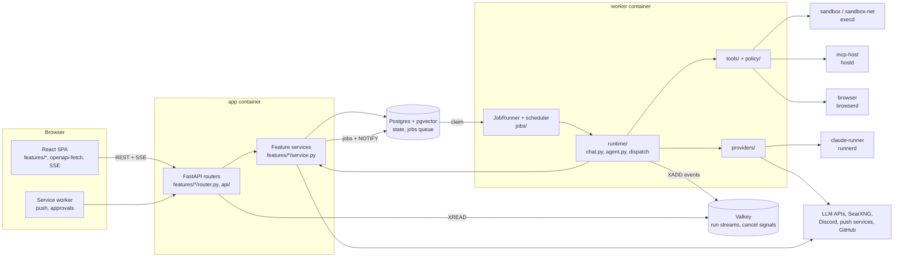

# Audit

Read-only audit of `main` at `7c4e988` (2026-11-08). Nothing in the application was changed for it.

The detailed findings are in four appendices. Each one has the full inventory for its part of the
code, with `file:line` for every item:

| Appendix | Covers |
|---|---|
| [audit/backend-api.md](audit/backend-api.md) | every HTTP route, every settings section and field, each backend feature folder, patterns, coupling, dead code, bugs, security |
| [audit/backend-core.md](audit/backend-core.md) | agent tools, jobs and periodic tasks, integrations, configuration and Redis keys, the run flow, runtime/providers/policy/tools/workspace, import cycles |
| [audit/frontend.md](audit/frontend.md) | every route and view, Home widgets, shortcuts, local storage keys, service worker and push, focus timer, music queue, per-feature API use, patterns, coupling |
| [audit/services-and-tests.md](audit/services-and-tests.md) | sandbox, mcp-host, browser, claude-runner, Compose and ZimaOS, scripts, CI, env vars, the test inventory and the coverage map |

Bugs from all four are collected in [BUGS.md](BUGS.md), ordered by severity.

## 1. Summary

The codebase is in better shape than the starting brief assumed. Both sides use one folder per
feature, duplicated code is under 1 %, there are no module-level import cycles in the backend, and
783 backend plus 197 frontend tests and 30 Playwright specs pass. The refactor is therefore
**targeted**: it fixes the few places where the structure causes bugs or makes changes hard
(see §4), and leaves the rest alone. Conventions for new code go into `CLAUDE.md`.

## 2. Feature inventory (the contract)

Everything listed in the appendices must still work at the end. In numbers:

| Kind | Count | Where in the appendices |
|---|---|---|
| HTTP routes | 212 under `/api` + the SPA catch-all (no websockets); 6 need no login | backend-api §1.1 |
| Settings sections | 13 (`general`, `appearance`, `models`, `permissions`, `workspace`, `web`, `memory`, `focus`, `music`, `home`, `files`, `setup`, `updates`) + the hidden `update_state` row | backend-api §2.0 |
| Backend feature folders | 29 | backend-api §2.1 |
| Agent tools | 57 built-in (a hand-written list in `tools/registry.py`) + MCP tools built at run time | backend-core §1 |
| Job types | 8 (`run.execute`, `conversation.title`, `memory.extract`, `memory.reindex`, `document.index`, `notify.deliver`, `automation.retry`, `mcp.refresh`) | backend-core §2.1 |
| Periodic tasks | 6 on one 30 s loop (reminders, automations, notification pruning, approval expiry, temporary chats, update check) + worker heartbeat and status loops | backend-core §2.2 |
| Integrations | OpenAI (Responses and Chat Completions), Anthropic, OpenAI-compatible and OpenRouter, Claude subscription through claude-runner, the fake provider; MCP (remote and through mcp-host); SearXNG and web fetch; browser; shell sandboxes; Discord webhooks; Web Push; GitHub update check | backend-core §3 |
| Process configuration | every `Settings` field in `core/config.py`; no other environment reads in `app/` | backend-core §4 |
| Frontend routes | 38, plus always-mounted surfaces (sidebar, command palette, island, notifications) | frontend §1 |
| Home widgets | 11 | frontend §1 |
| Keyboard shortcuts | 29 ids in one registry | frontend §1 |
| Browser storage keys | 11 local/session storage keys + the service worker cache (renaming one is a behaviour change) | frontend §2 |
| Side services | execd (sandbox, sandbox-net), hostd (mcp-host), browserd, runnerd | services-and-tests §A |

Corrections to the original brief, confirmed in the code:

- **Music queue.** Pasting a link, the command palette, a playlist's "Add to queue" and the agent's
  music control without `replace` **append** (`player.add` / `player.append`). A playlist's
  Play/Shuffle (`PlaylistsPanel.tsx`) and the agent's control with `replace` (`chat/agentControl.ts`)
  **replace** the queue (`player.playTracks`). Both behaviours are pinned as they are.
- There is **no Companion extension** in the repository.
- **ntfy** notifications are mentioned in the docs but do not exist in the code. Only Discord
  webhooks and Web Push deliver notifications.

## 3. Current architecture

The app never calls a model itself: a turn becomes a `runs` row and a `run.execute` job, a worker
claims it, and `runtime/dispatch.py` hands it to `execute_chat_run` or `execute_agent_run`. Events go
to a Valkey stream per run, which the API relays to the browser over SSE. The sequence diagram is in
backend-core §5.

Import direction today, measured: `core` ← everything; `policy`, `web` (except its router) and
`workspace` (except `revert.py`) are pure; `providers` and `tools.base` depend on a few feature
modules; `runtime` depends on providers, tools, policy, events, jobs and 19 feature modules.
Five feature pairs depend on each other (for example `conversations` ↔ `runs`, `settings` ↔
`memory`). On the frontend, 14 feature pairs import each other and there are two import cycles.

## 4. Problems, ranked by impact

Only problems that cause bugs or make changes harder are listed. Things that merely differ are not.

| # | Problem | Evidence | Why it matters | Plan |
|---|---|---|---|---|
| 1 | **`runtime/agent.py` is a god file.** 1,623 lines, twice the next-largest. `AgentRun` is 826 lines; `_process_tools` (197 lines) handles crash-resume, approvals, questions, plan review, permissions and denials in one loop where the order of early `continue`/`return`s matters; `execute_agent_run` (178 lines) does set-up, driving and outcome handling in one function. | `runtime/agent.py:246-1071`, `:679-875`, `:1431-1608` | Every change to approvals, plan review or resume touches the same long loop; the ordering rules are implicit. | PR 3 and PR 4 |
| 2 | **The run lifecycle is duplicated between chat and agent runs, and lives in the chat module.** Both load and early-exit, count restarts, start a cancel watcher, map `CancelledError`/`ProviderError`, and schedule title and memory follow-ups. `agent.py` imports the watcher, the cancel flag and the title follow-up from `chat.py`. The two already differ: chat counts every pickup (gives up after 1 crash), agent counts only resumes (after 2), and chat skips the duplicate-job check. Neither catches other exceptions, so a run can stay "running" forever. | `runtime/chat.py:109-206`, `:209-340`; `runtime/agent.py:76-82`, `:1431-1608` | Two copies drift (they already have), and a lifecycle fix has to be made twice. | PR 2 (the differences go into BUGS.md and get pinned; the stuck-run fix is a separate commit) |
| 3 | **`formatSize` exists three times with different output.** The Files page shows one decimal ("12.3 KB"), the other two round ("12 KB"); the links version returns `''` for a missing size. | `frontend/src/lib/format.ts:77`, `features/links/files.ts:4`, `features/files/FilesPage.tsx:56` | A change to how sizes look has to be found and made three times. | PR 5: one function with a decimals option, no visible change |
| 4 | **`dump.rdb` is committed.** A Valkey snapshot of old dev/test run events (chat text from test prompts; no keys, tokens or passwords). | repo root, commit `7d0d29f` | Repo hygiene; it ships with every clone. | PR 6: remove it and ignore it, no history rewrite |
| 5 | **`docs/architecture.md` no longer matches the code.** It was the plan for an empty repository: ten features are missing, several routes have other methods or paths, some promised mechanisms (an `O_NOFOLLOW` re-check, ntfy) don't exist. | backend-api §10, services-and-tests §A | Contributors and coding agents read it first and get wrong instructions. | PR 7 |
| 6 | **No enforced boundaries.** The direction in §3 holds by convention only; the frontend has two import cycles. | §3 | New code can add cycles and cross-layer imports without anyone noticing. | PR 7: import-linter and dependency-cruiser rules that encode today's direction and forbid new cycles; no rewrite of existing code |

### Looked at and left alone

These were reviewed and are not worth changing in this refactor:

- The four backend `slugify` functions: they differ in separator, length and fallback on purpose.
- The per-feature `useRefresh` hooks: each refreshes different data.
- `conversations/service.py` (759 lines), `providers/adapters/claude_code.py` (715) and
  `policy/shell_risk.py` (679): big, but no function in them is over about 170 lines.
- The provider adapters' similar code: they talk to different APIs.
- Mixed conventions that cause no bug today (commits in routers and in services, two PATCH styles,
  query keys as constants or inline arrays, uuid4 and uuid7 ids, five ways of validating a time zone,
  hard-coded `text-[Npx]` sizes). They are written down as conventions for **new** code in
  `CLAUDE.md`; existing code is not rewritten to match. Where one of them causes a bug, the bug is
  in BUGS.md.
- The generated `schema.d.ts` and `openapi.json`.

### Dead-code candidates (not removed; deleting is the owner's decision)

Each was checked for dynamic use (registration by name, string routes, the frontend, e2e, docs):

| Candidate | Where | Note |
|---|---|---|
| `auth.purge_expired` | `features/auth/service.py:163` | never called, so expired sessions are never deleted (also in BUGS.md) |
| `runs.active_run_for_conversation` | `features/runs/service.py` | |
| `extract_pdf_text`, `_uploads_dir`, `KIND_LABELS`, `MAX_EXTRACTED_CHARS` | `features/attachments/service.py` | leftovers after `extract.py` was split out |
| `session_scope` | `core/db.py` | |
| `max_risk` | `policy/shell_risk.py:678` | |
| `GET /api/tools` | route | no caller in the frontend, e2e or docs |
| `confirm_destructive_actions` setting | `features/settings/sections.py` | stored and returned, read by nothing |
| `trusted_proxies`, `tz` settings | `core/config.py` | never read; `TRUSTED_PROXIES` works only through `FORWARDED_ALLOW_IPS` in Compose |
| `pg_trgm` extension | migrations | installed, no index or query uses it |
| `useCreateModel`, `assets/hero.png`, `assets/vite.svg` | frontend | |

## 5. Security

Reported to the owner as soon as they were found. Status is kept in BUGS.md.

| # | Severity | Issue | Where | Decision |
|---|---|---|---|---|
| 1 | Medium-High | Agent file tools check a path and open it later; the agent's shell shares the workspace and can swap a folder for a symlink in between, so a read can reach the worker's `/proc/self/environ` (master key, DB password) or a write can land outside the workspace. The docs claim an `O_NOFOLLOW` re-check that doesn't exist. | `workspace/files.py:106-160`, `workspace/fs_guard.py`, `tools/builtin/workspace.py` | fix now, own PR |
| 4 | Medium-High | Model-written Markdown loads remote images automatically and there is no Content-Security-Policy, so a prompt injection can leak data with no click. | `frontend/src/components/ui/Markdown.tsx` | fix now, own PR |
| 5 | Medium | Restoring a trash item trusts `.meta.json`, which the agent's shell can edit; `name` is not checked, so a restore can move any file the app can read into the workspace. | `workspace/files.py:285-294` | fix now, own PR |
| 6 | Medium (design) | With the default permissions an agent can read files and send them out through `read_web_page` or search without asking; memory writes need no approval either. | `policy/presets.py:36-76` | owner's decision on default permissions |
| 2 | Low | `POST /api/documents` creates folders outside the workspace before validating `folder`, then fails with a 500. | `features/documents/service.py:396-401` | BUGS.md |
| — | Low-Medium | Shell risk rating misses destructive commands (`python3 -c`, `busybox rm`, `git -c core.fsmonitor=`). | `policy/shell_risk.py` | BUGS.md |
| — | Low-Medium | A profile's `plan_review` can override the global "always review plans" without re-auth. | `features/profiles/router.py:85-89` | BUGS.md |
| — | Low | Shared `egress` network between the optional containers; the networked shell reaches the LAN regardless of the private-host allowlist; app, worker and migrate have no container hardening; ZimaOS ships `ADMIN_PASSWORD: CHANGE_ME` and the app accepts it; the policy engine allows a tool call with no actions; YouTube/SoundCloud scripts in the app origin; `/\host` passes the internal-link check; login lock-out through the global counter; SSE streams outlive logout; Discord sends without a private-host guard; share tokens in plain text; credentials in the audit log. | see the appendices | BUGS.md |

Git history has no real secrets, only test fixtures.

## 6. Test coverage gaps

Every critical flow has backend API tests and an end-to-end spec, except where noted. The full
matrix is in services-and-tests §B.6.

| Flow | Gap |
|---|---|
| Music queue | Nothing tests appending to a queue that is already playing, or `agentControl.ts` choosing `playTracks` (replace) vs `append`. No e2e of a playlist's Play replacing the queue. |
| Run lifecycle (chat vs agent) | Restart counting is tested for chat once and for agent once; the difference between them, a duplicate job for a running chat, and exceptions other than provider errors are not pinned. |
| Worker loop | `jobs/runner.py`, `jobs/scheduler.py` and `main_worker.py` are at 0 % (tests run jobs in-process). |
| Shell sandbox | No e2e; container hardening is never checked by a test; the sandbox and mcp-host images are not built in CI. |
| Calendar, memories | No frontend unit tests (covered by API tests and e2e). |
| Provider adapters | `openai_chat.py` 24 %, `anthropic.py` 59 % (the fake provider stands in for them). |
| Conversations | `conversations/service.py` 47 %, `conversations/router.py` 60 %. |
| Tool approval | "Deny" and "always allow" are covered by API tests but not by e2e. |
| API contract | No test compares the generated OpenAPI schema with the committed one. |

Only the gaps in areas this refactor touches get new tests (the run lifecycle, the agent loop,
`formatSize`), plus the OpenAPI snapshot and the missing music-queue cases from the smoke list.
