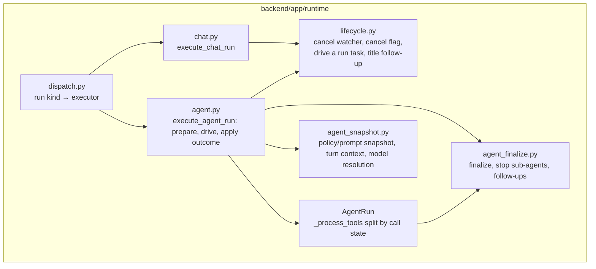

# Refactor plan

Approved by the owner on 2026-11-08 (answers 1a, 2a, 3a, 4a, 6a, 7a). The scope is **targeted**:
fix the places where the structure causes problems (see AUDIT.md §4) and leave working code alone.

## Ground rules

- One branch and one PR per area, each branched off the latest `main` and rebased onto it before
  the PR is opened. Never commit to `main`. Branches are named `refactor/<area>` (refactors) or
  `fix/<area>` (behaviour changes).
- One concern per commit. A refactor commit never changes behaviour; a behaviour change goes in its
  own commit whose message starts with `Behaviour change:`.
- Move code before changing it: relocate it unchanged and commit, then restructure and commit.
- After every commit: `ruff check`, `ruff format --check`, `mypy app`, the full `pytest` suite,
  `alembic check`, and for frontend changes `npm run typecheck && npm run lint && npm test && npm run build`.
  A red step is fixed or reverted, never built on.
- Tests are never weakened, skipped or deleted to get green. If one turns out to be wrong, the owner is told.
- Characterization tests go in first, and only where the existing tests don't already pin the
  behaviour of the code being changed.
- E2E: CI runs the full Playwright suite on every PR (`e2e/run-isolated.sh`). For the flows a PR
  touches, the app, worker and sandbox are also run locally as plain processes against a throwaway
  database.
- `refactor/PROGRESS.md` is updated in every PR.

## Target architecture

The current structure stays. The changes are inside `backend/app/runtime/` plus one frontend
helper, and the existing dependency direction gets enforced by tools.



Layers and the allowed direction, which PR 7 encodes as import rules:

```mermaid
flowchart LR
  API[api/ + features/*/router.py] --> SVC[features/*/service.py]
  JOBS[jobs/] --> RT[runtime/]
  RT --> TOOLS[tools/]
  RT --> PROV[providers/]
  RT --> SVC
  TOOLS --> POLICY[policy/ (pure)]
  TOOLS --> SVC
  TOOLS --> WS[workspace/]
  SVC --> CORE[core/, db/, events/]
  PROV --> CORE
  WS --> CORE
```

- `core`, `policy`, `web` (except its router) and `workspace` (except `revert.py`) import no
  feature, runtime or API module. The known exceptions (provider registry, `tools.base`,
  `workspace/revert.py`) are listed in the rules, so they don't grow.
- `runtime` is imported only by `jobs` and the few routers that already use `runtime.outputs`.
- `chat.py` and `agent.py` share run-lifecycle code through `lifecycle.py`, not through each other.
- Frontend: features may import `components/`, `lib/`, `hooks/`, `api/` and today's cross-feature
  edges; no new import cycles.

## Conventions

The conventions for **new** code are written into the root `CLAUDE.md` (PR 7): where each kind of
code goes, and one way each for DB access, errors, logging, config, validation, API responses,
frontend state and styling, with a reference example from the existing code. Existing code is
not rewritten to match.

## Steps, in order

| # | Branch | What | Size (lines that aren't moves) |
|---|---|---|---|
| 0 | `refactor/notes` | This folder: AUDIT (+ appendices), PLAN, DECISIONS, BUGS, BASELINE, PROGRESS. | docs only |
| S1 | `fix/workspace-symlink-race` | Security #1: agent file tools open paths without following symlinks at any step and check that what was opened is inside the workspace. Reproducing test first. | ~150 |
| S2 | `fix/markdown-remote-images` | Security #4: remote images in Markdown are shown as a link to click, not loaded; images from the app itself still load. Test first. | ~80 |
| S3 | `fix/trash-restore-name` | Security #5: restoring a trash item only moves the item stored in its own slot. Test first. | ~40 |
| 1 | `refactor/safety-net` | OpenAPI snapshot test (`python -m app.cli export-openapi` vs `frontend/src/api/openapi.json`); `pytest-cov` and `@vitest/coverage-v8` as dev dependencies, with coverage commands; first frontend coverage measurement on unchanged code; the missing music-queue tests (appending to a playing queue; `agentControl` replace vs append). | ~150 |
| 2 | `refactor/run-lifecycle` | Pin chat vs agent restart counting, a duplicate job for a running chat, shutdown vs user cancel, provider errors and refusals in agent mode, and what happens on other exceptions. Move the cancel watcher, cancel flag and title follow-up from `chat.py` into `runtime/lifecycle.py` unchanged; then extract the shared "drive the run task with a cancel watcher and map the outcome" block used by both. Restart counting stays different for each. Then, as a separate behaviour-change commit: a run whose executor raises an unexpected exception is failed instead of staying "running" (BUGS.md core-B1). | ~150 + fix |
| 3 | `refactor/agent-modules` | Pure move out of `agent.py`: `_snapshot`, `_add_turn_context`, `_resolve_models`, `session_key_for` → `runtime/agent_snapshot.py`; `_finalize`, `_stop_subagents`, `_save_progress`, `_after_answer`, `_notify_question`, `_denial` → `runtime/agent_finalize.py`. | ~0 (≈400 moved) |
| 4 | `refactor/agent-loop` | Pin the orderings not yet covered (a pause right after an approval is decided, a question while unattended, unattended "continue without" vs "stop", a plan-review denial). Split `_process_tools` by call state (calls already in progress: waiting for a sub-agent, waiting for approval, interrupted mid-run; new calls: validate, question, plan review, permission verdict), keeping the exact order of the early exits. Split `execute_agent_run` into prepare, drive and apply-outcome. | 200–300 |
| 5 | `refactor/format-size` | One `formatSize(bytes, { decimals })` in `lib/format.ts`; the Files page keeps one decimal, the links call site keeps its empty string for a missing size. Tests pin all three outputs first. | ~30 |
| 6 | `chore/remove-dump-rdb` | `git rm dump.rdb`, add `*.rdb` to `.gitignore`. No history rewrite. | 2 |
| 7 | `refactor/conventions` | Root `CLAUDE.md`; update `docs/architecture.md` to match the code; `import-linter` (backend) and `dependency-cruiser` (frontend) rules for today's direction with no new cycles, run in CI and `make lint`; the final before/after report against BASELINE.md. | ~150 |

The security fixes come first because they are independent of the refactor and the most urgent.
PRs 2 → 3 → 4 touch the same files and go in that order; PRs 1, 5, 6 and the security fixes are
independent of each other.

## Risks

| Risk | Handling |
|---|---|
| The order of early exits in `_process_tools` is behaviour (pause vs approval vs crash-resume). | Characterization tests for each ordering before the split; the split keeps the checks in the same sequence and only moves branches into methods. |
| Chat and agent runs differ in restart counting and duplicate-job handling. | Logged in BUGS.md, pinned by tests, and kept as is; the shared helper takes the differing parts as parameters. |
| Long-lived branches conflict with features being merged into `main`. | Small PRs, rebased right before opening; agent.py PRs are opened one at a time. |
| The worker loop is not covered by tests (0 %). | The refactor doesn't touch `jobs/`; the lifecycle tests drive the executors directly as the existing tests do. |
| E2E can't run in this container's Docker. | CI runs it on every PR; flows a PR touches are also checked locally with the processes run directly. |
| Security fixes change behaviour users can see (a remote image becomes a link). | Each is its own PR marked as a behaviour change, described for manual testing. |
| A new import-boundary rule fails on existing code. | The rules encode the measured current state; exceptions are listed explicitly rather than code rewritten. |
